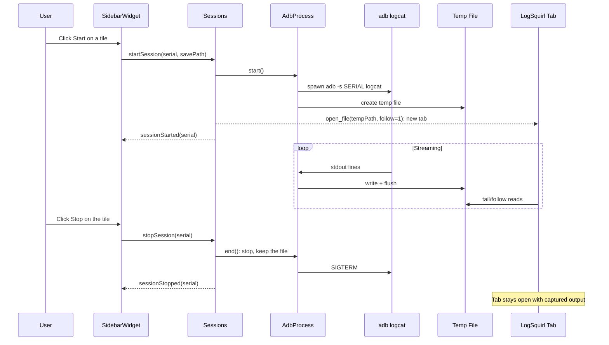
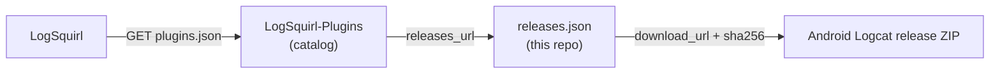

<!-- Allow GitHub's presentation markup and a logo before the main heading. -->
<!-- markdownlint-configure-file {"MD033": {"allowed_elements": ["div", "img"]}, "MD041": false} -->

<div align="center">


# Android Logcat

**Every device its own tab.**

**A [LogSquirl](https://github.com/64x-lunicorn/LogSquirl) plugin that streams
Android `logcat` straight into the log viewer.**

Capture from several ADB devices at once and read the output with the same
regex search and highlighters you use on any other log.

[](https://github.com/64x-lunicorn/LogSquirl-Logcat/actions/workflows/ci-build.yml)
[](https://github.com/64x-lunicorn/LogSquirl-Logcat/releases/latest)
[](https://github.com/64x-lunicorn/LogSquirl-Logcat/releases)
[](#install)
[](LICENSE)

[Install](#install) &nbsp;/&nbsp;
[Usage](#usage) &nbsp;/&nbsp;
[Build](#build) &nbsp;/&nbsp;
[Architecture](#architecture) &nbsp;/&nbsp;
[Changelog](CHANGELOG.md)

</div>

---

## Why this plugin?

`adb logcat` in a terminal scrolls away faster than you can read it, and one
terminal means one device. This plugin puts every device in its own tab, in the
viewer where your other logs already are.

| Less setup | More signal |
| :--- | :--- |
| **Finds `adb` itself.** Looks in `ANDROID_HOME`, `ANDROID_SDK_ROOT`, `PATH` and the usual platform locations; override it in the settings dialog. | **Every device its own tab.** Start as many as you like — each opens in follow mode and keeps streaming. |
| **Devices found for you.** A device you plug in gets its tile in the sidebar by itself; devices seen before stay until you forget them. | **Nothing lost on stop.** Captured output stays in the tab after the session ends. |
| **Written to disk.** Configurable log directory, automatic `YYYY-MM-dd_HHmmss_<serial>.log` names, or a save path per device. | **Filter with the host.** No filter UI of its own — LogSquirl's regex search and highlighters do it better. |
| **One tile per device.** Start, stop and rotate from the device's tile, which shows whether it is connected, unauthorized or offline, and while it runs, its lines, bytes, lines/s and file size, live. | **A worked example.** Heavily commented reference implementation for the Plugin SDK. |

## Install

### From LogSquirl

*Plugins → Browse Plugins…* → **Android Logcat** → **Install**. The archive is
downloaded, verified against its SHA-256 checksum and loaded — no file copying.

### From a release

Download the archive for your platform from the
[releases page](https://github.com/64x-lunicorn/LogSquirl-Logcat/releases/latest)
and unpack it into LogSquirl's plugin directory:

| Platform | Plugin Directory |
|----------|-----------------|
| macOS    | `~/Library/Application Support/logsquirl/plugins/io.github.logsquirl.logcat/` |
| Linux    | `~/.local/share/logsquirl/plugins/io.github.logsquirl.logcat/` |
| Windows  | `%APPDATA%/logsquirl/plugins/io.github.logsquirl.logcat/` |

### From source

See [Build](#build), then:

```bash
DEST="$HOME/Library/Application Support/logsquirl/plugins/io.github.logsquirl.logcat"
mkdir -p "$DEST"
cp build/liblogsquirl_logcat.dylib "$DEST/"
cp plugin.json icon.png presets/logcat_filter.conf presets/logcat_highlighter.conf "$DEST/"
```

Or `cmake --install build --prefix "$HOME/.local"`.

After installing, restart LogSquirl or re-scan via *Plugins → Manage Plugins…*.

## Usage

1. **Enable the plugin** in *Plugins → Manage Plugins…* — check
   "Android Logcat" and click OK.  (On first run, the plugin is
   auto-enabled if no other plugins are configured.)

2. The **Logcat** sidebar tab appears automatically, with **one tile per
   device**.

   <!-- screenshot: docs/images/sidebar.png — the Logcat sidebar tab with
        three tiles: one running (its details: running time, lines/s, lines,
        bytes, file size, rotations; ↻ Rotate), one connected, one unplugged
        (greyed, with Forget). -->

   > **Screenshot pending:** the Logcat sidebar tab.

   - **Plug in a device** (USB debugging on) and its tile appears by
     itself, titled by model and serial, e.g. `Pixel 8 · 3A1B…`. The devices
     are rescanned every 3 seconds while the tab is shown.
   - The tile's dot and summary say whether the device is **connected**,
     **running**, **unauthorized** (allow USB debugging on the device),
     **offline** or **disconnected**. Only a connected device can be started.
   - **Start** — Begin capturing logcat for the device. A new tab opens in
     LogSquirl with live output in follow mode.
   - **While it runs**, the tile shows the capture's details, updated every
     second: how long it runs and the lines per second, the lines and bytes
     since Start, the size of the current file and how often it was rotated,
     and when it rotates next (on request: logcat has no size limit). A
     stopped tile shows only the device.
   - **Stop** — Stop the capture. The tab remains open with all captured
     output preserved.
   - **↻ Rotate** (while it runs) — Go on in a new file, in a new tab; the
     old tab keeps its file.
   - **Save to…** — Append this device's logcat to a file of your choice
     instead of a new file in the log directory at each Start; empty it to
     use the log directory again.
   - **Forget** — An unplugged device keeps its tile, greyed out, also after
     a restart of LogSquirl, until you forget it. Plug it in again and it is
     back.
   - **Stop all** — Stop every capture.

3. **Settings…** in the tab opens the settings dialog:

   <!-- screenshot: docs/images/settings.png — the Logcat settings dialog
        with a log directory and the detected adb. -->

   > **Screenshot pending:** the settings dialog.

   - **Log directory** — Where a device without a save path of its own
     writes, one file per Start, named `YYYY-MM-dd_HHmmss_<serial>.log`.
     Empty: `logs/` in the plugin's settings directory.
   - **ADB** — The full path to the `adb` executable, or empty for
     auto-detection. A new path is used for a device scan right away.

4. **Multiple devices** — Click Start on another tile. Each device gets its
   own tab and session.

5. **The Android Logcat dialog** — *Plugins → Android Logcat…* opens a
   dialog with a device list, Start/Stop and a save path; it shows the same
   sessions as the tab. *Plugins → Manage Plugins…* → select plugin →
   **Configure** sets the ADB path, as the settings dialog does.

### Screenshots still to take

The screenshots are taken when the tiles are first tried in LogSquirl;
until then each has a marked placeholder above:

| File | Shows |
|------|-------|
| `docs/images/sidebar.png` | The Logcat sidebar tab: a running tile with its details and ↻ Rotate, a connected and an unplugged (greyed) tile |
| `docs/images/settings.png` | The settings dialog: the log directory and the detected adb |

### Filters and highlighters

The plugin brings a filter group and a highlighter set for the logcat it
writes (the *threadtime* format, also with a user column):

- **Filter group *Logcat*** ([`logcat_filter.conf`](presets/logcat_filter.conf)):
  *Crashes* (`FATAL EXCEPTION` and the `AndroidRuntime` stack trace, native
  `Fatal signal` and tombstone lines, `beginning of crash`), *ANRs*
  (`ANR in …`) and *Errors and worse* (every `E` and `F` line). They are
  listed in the Filters tab of the Filters Panel.
- **Highlighter set *Logcat levels***
  ([`logcat_highlighter.conf`](presets/logcat_highlighter.conf)): fatal
  lines white on dark red, errors on light red, warnings on amber. Switch
  it on in the **Highlighters** menu.

On LogSquirl 26.12 and later both are read from the plugin's directory
while the plugin is enabled, named *Logcat (Android Logcat)* and *Logcat
levels (Android Logcat)*: nothing to import. They are read-only; *Copy to
my groups* makes a copy you can change. On an older LogSquirl, take the two
files from the release archive, where they lie next to the library, or from
the [`presets`](presets/) folder, and import each once: **Tools →
Predefined filters…** and **Highlighters → Configure highlighters…**,
*Import*, **OK**.

LogSquirl already recognises the logcat format itself (its built-in
`logcat_log` Log Format): Table View, levels and timestamps need no file
from the plugin.

## Prerequisites

- **LogSquirl** ≥ 26.03 with the plugin system enabled
- **Qt6** (Core + Widgets) — same version LogSquirl was built with
- **CMake** ≥ 3.16
- **ADB** (Android Debug Bridge) — part of the
  [Android SDK Platform-Tools](https://developer.android.com/tools/releases/platform-tools)
- A C++17-capable compiler (GCC ≥ 9, Clang ≥ 14, MSVC ≥ 19.29)

## Build

```bash
# Clone
git clone https://github.com/64x-lunicorn/LogSquirl-Logcat.git
cd LogSquirl-Logcat

# Configure
cmake -B build -S . -DCMAKE_BUILD_TYPE=Release

# If Qt6 is not in PATH (e.g. Homebrew on macOS):
cmake -B build -S . -DCMAKE_BUILD_TYPE=Release \
  -DCMAKE_PREFIX_PATH="$(brew --prefix qt6)"

# Build
cmake --build build

# The shared library is in build/:
#   macOS:   build/liblogsquirl_logcat.dylib
#   Linux:   build/liblogsquirl_logcat.so
#   Windows: build/logsquirl_logcat.dll
```

### Running Tests

```bash
cmake -B build -S . -DCMAKE_BUILD_TYPE=Release -DBUILD_TESTS=ON
cmake --build build
cd build && ctest --output-on-failure
```

CI also runs the tests in Debug on Linux x64 under AddressSanitizer and
UndefinedBehaviorSanitizer, without leak detection (`"sanitizers": true` in
`.github/plugin-ci.json`); a sanitizer report fails the build.

## Architecture

```mermaid
graph TD
    subgraph LogSquirl Host
        H[MainWindow]
        SB[Sidebar Panel]
    end

    subgraph Plugin — C ABI Boundary
        P[plugin.cpp<br/>get_info / init /<br/>shutdown / configure]
        SW[SidebarWidget<br/>one DeviceTile per device]
        ST[DeviceStore<br/>devices seen before]
        SET[Settings<br/>logcat.ini: ADB path, log directory]
        DW[DeviceWidget<br/>dialog]
        DS[DeviceScan<br/>adb devices -l, through a port]
        S[Sessions<br/>a logcat session per device]
        AP1[AdbProcess #1<br/>emulator-5554]
        AP2[AdbProcess #2<br/>R5CR10XXXXX]
    end

    H -- register_sidebar_tab --> P
    P -- creates --> SET
    P -- creates --> DS
    P -- creates --> S
    P -- creates --> SW
    P -- creates --> DW
    P -- creates --> ST
    SW -- view of --> DS
    SW -- view of --> S
    SW -- view of --> ST
    DW -- view of --> DS
    DW -- view of --> S
    S -- sessionEnded: rescan --> DS
    SET -- adbPathChanged: restart --> DS
    SW --> SB
    S -- manages --> AP1
    S -- manages --> AP2
    AP1 -- writes --> TF1[Temp File #1]
    AP2 -- writes --> TF2[Temp File #2]
    TF1 -- open_file follow=1 --> H
    TF2 -- open_file follow=1 --> H
```

### Data Flow



### Key Design Decisions

| Decision | Rationale |
|----------|-----------|
| **Plugin type = UI** | The DataSource type is limited to 1 stream per plugin. UI type allows managing multiple independent streams. |
| **open_file() instead of push_line()** | Each device writes to its own temp file. The host opens each file with follow/tail mode → one tab per device. |
| **register_sidebar_tab()** | Plugin registers a sidebar widget that is always visible while the plugin is loaded. The sidebar shows one tile per device, connected or seen before, each with its own controls. |
| **A tile per device, not per configuration** | A logcat session has hardly any settings: a device's tile is all there is to it, and the few settings (log directory, ADB path) live in a dialog opened from the tab. |
| **QProcess for ADB** | Cross-platform, integrates with Qt event loop, no need for threading. |
| **No built-in filtering** | LogSquirl's regex search and highlighters are more powerful than any filter we could build. The plugin only ships ready-made groups for them (`presets/`, named in `plugin.json`). |
| **Library name without extension** | `plugin.json` uses `"library": "logsquirl_logcat"` — QLibrary resolves the platform suffix automatically. |

## Project Structure

```
logsquirl-logcat/
├── CMakeLists.txt              # Standalone build — finds Qt6, builds shared lib
├── plugin.json                 # Plugin manifest (cross-platform)
├── presets/                    # Filter group and highlighter set (plugin.json names them)
├── LICENSE                     # GPL-3.0-or-later
├── README.md                   # This file
├── CHANGELOG.md                # Release history
├── .gitignore
├── include/
│   └── logsquirl_plugin_api.h  # Vendored SDK header (MIT license)
├── src/
│   ├── plugin.h                # Global state shared across translation units
│   ├── plugin.cpp              # C ABI entry points (get_info, init, shutdown)
│   ├── adbprocess.h            # Per-device logcat QProcess wrapper, device list parsing
│   ├── adbprocess.cpp
│   ├── devicescan.h            # Device scan (adb devices -l) behind a port, QProcess adapter
│   ├── devicescan.cpp
│   ├── logfile.h               # The file a Session writes: open, write, Rotate, temp dir
│   ├── logfile.cpp
│   ├── sessions.h              # Sessions (start/stop/rotate, counters)
│   ├── sessions.cpp
│   ├── devicewidget.h          # The Android Logcat dialog, a view of the scan and Sessions
│   ├── devicewidget.cpp
│   ├── sidebarwidget.h         # LogSquirl sidebar tab: one tile per device
│   ├── sidebarwidget.cpp
│   ├── deviceroster.h          # What each tile shows: devices + sessions → rows
│   ├── deviceroster.cpp
│   ├── tilestate.h             # A tile's state, shared by the roster and the tile
│   ├── devicetile.h            # A device's tile (card): state, Start/Stop, Forget
│   ├── devicetile.cpp
│   ├── devicestore.h           # Devices seen before, their save paths
│   ├── devicestore.cpp
│   ├── settings.h              # logcat.ini: finding adb, the ADB path, the log directory
│   ├── settings.cpp
│   ├── settingsdialog.h        # The tab's settings: log directory, ADB path
│   └── settingsdialog.cpp
├── tests/
│   ├── CMakeLists.txt          # Catch2 test setup
│   ├── tests_main.cpp          # QApplication + Catch2 runner
│   ├── parsedevicelist_test.cpp
│   ├── plugininfo_test.cpp
│   ├── presets_test.cpp        # The shipped filter group and highlighter set
│   ├── devicetile_test.cpp     # The tile on its own
│   ├── devicestore_test.cpp    # Remembering devices, where logs go
│   ├── settings_test.cpp       # Finding adb, the ADB path, the log directory, on a temp ini
│   ├── deviceroster_test.cpp   # Table tests: what each tile shows
│   ├── devicescan_test.cpp     # The device scan, its runs completed by the test
│   ├── fakeadbdevices.h        # The scan's test adapter: a test ends each run
│   ├── sidebarwidget_test.cpp  # The tab over a fake adb
│   ├── logfile_test.cpp        # The log file on real temp files, without adb
│   └── adbprocess_test.cpp
└── docs/
    └── DEVELOPER_GUIDE.md      # How to use this as a plugin template
```

## Plugin Registry

This plugin is listed in the
[LogSquirl-Plugins](https://github.com/64x-lunicorn/LogSquirl-Plugins) catalog,
so it installs from **Plugins → Browse Plugins…** with no manual file copying.

The catalog holds **one entry per plugin** and does not change between releases.
Versions, download URLs and checksums live in this repository's
[`releases.json`](releases.json) — update that when you publish a release, and
fill in every `sha256`: an empty checksum silently disables verification in the
host.



## Using This as a Plugin Template

This plugin is designed to be a starting point for your own LogSquirl plugins.
See [docs/DEVELOPER_GUIDE.md](docs/DEVELOPER_GUIDE.md) for a step-by-step
guide on how the Plugin SDK works, annotated code walkthroughs, and tips for
building your own plugins.

**Quick start to fork this as a template:**

1. Copy this directory
2. Rename the library in `CMakeLists.txt`
3. Update `plugin.json` with your plugin's identity
4. Modify `plugin.cpp` entry points
5. Replace `AdbProcess` + `Sessions` with your own logic
6. Build and install

## License

GPL-3.0-or-later — see [LICENSE](LICENSE) for the full license text.

The vendored `include/logsquirl_plugin_api.h` header is MIT-licensed, so
plugins of any license can build against the LogSquirl Plugin SDK without
taking on GPL obligations. See [NOTICE](NOTICE) for details.
